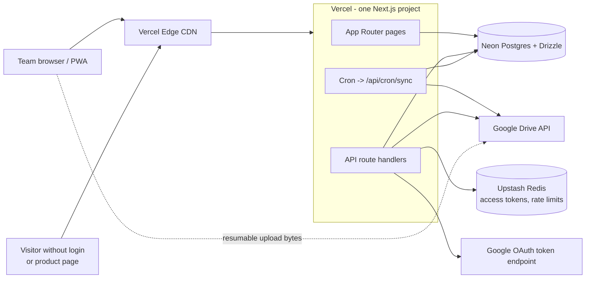
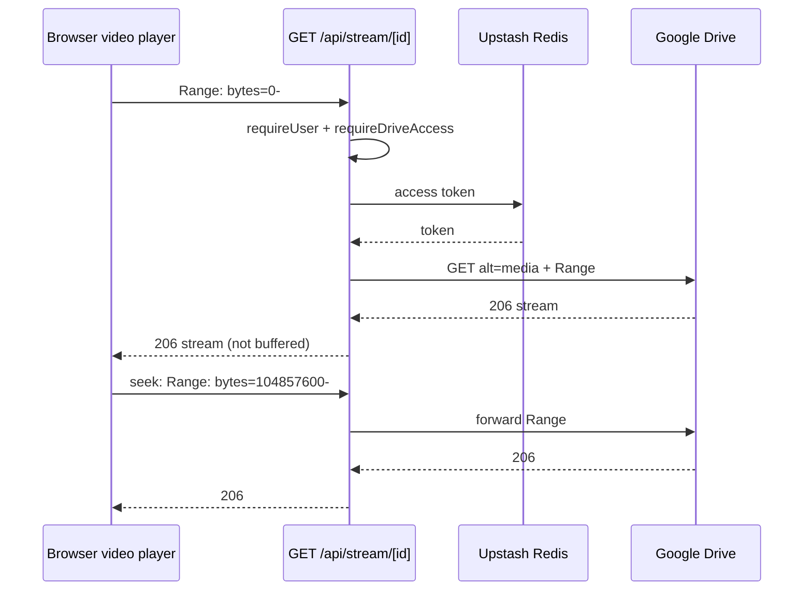
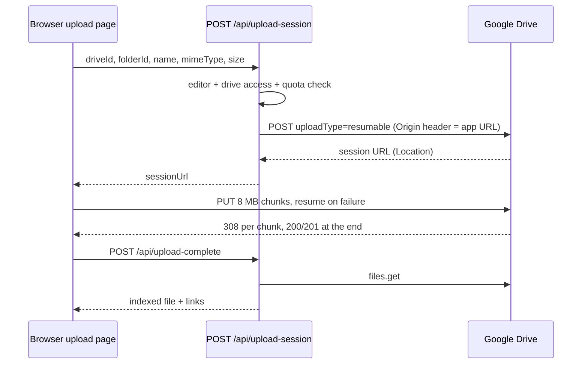

# Open Drive — Architecture

Open Drive is a private team portal that connects any number of Google Drive accounts. It indexes them into Postgres for instant browsing and search, streams media through Vercel routes, and issues public links (`/s/`, `/i/`) that work for visitors who are not logged in. Everything runs on **Vercel only**.

**Stack:** Next.js 15 (App Router) + TypeScript on Vercel Pro · Auth.js v5 (Google login) · Neon Postgres + Drizzle ORM · Upstash Redis (access-token cache, rate limits) · Vercel Cron (Drive Changes sync) · Tailwind + shadcn/ui · PWA.

## System diagram



## Auth model (owner approval)

- Anyone can sign in with Google (Auth.js v5, scopes `openid email profile`). The sign-in callback upserts a `users` row with `status = 'pending'`.
- The account whose email equals `OWNER_EMAIL` becomes `role = 'owner'`, `status = 'approved'` on first sign-in.
- Middleware sends signed-in pending users to `/pending` and signed-out users to `/login`.
- Every API handler calls `requireUser()` (session → user row → `status = 'approved'`), then `requireDriveAccess(user, driveAccountId, needEdit)` for any Drive-scoped work.
- Roles: `viewer` (read) · `editor` (upload, rename, delete, links, annotations) · `admin` (connect Drives, approve users, settings) · `owner` (admin + cannot be demoted).
- `owner` and `admin` see every Drive. `viewer` and `editor` see only Drives listed in `user_drive_access`; editing in a Drive also needs `can_edit = true` there.
- Suspension takes effect on the next request.

## Repository layout

```
src/
  app/                                  # routes and layouts only
    login/page.tsx
    pending/page.tsx
    (portal)/layout.tsx                 # explorer shell: tree, top bar, preview pane
    (portal)/page.tsx                   # dashboard
    (portal)/drive/[[...path]]/page.tsx # explorer
    (portal)/upload/page.tsx
    (portal)/links/page.tsx
    (portal)/team/page.tsx
    (portal)/settings/page.tsx
    s/[slug]/page.tsx                   # public link page (view or edit)
    i/[slug]/route.ts                   # public image bytes, CDN cached
    manifest.ts                         # PWA manifest
    api/auth/[...nextauth]/route.ts
    api/connect/drive/route.ts
    api/connect/drive/callback/route.ts
    api/drives/route.ts
    api/folders/route.ts
    api/files/[id]/route.ts
    api/files/[id]/google-edit/route.ts
    api/search/route.ts
    api/thumb/[id]/route.ts
    api/stream/[id]/route.ts
    api/upload-session/route.ts
    api/upload-complete/route.ts
    api/links/route.ts
    api/links/[slug]/route.ts
    api/s/[slug]/upload-session/route.ts
    api/admin/users/route.ts
    api/admin/users/[id]/route.ts
    api/settings/route.ts
    api/cron/sync/route.ts
  components/
    ui/                                 # shadcn/ui primitives
    explorer/   Sidebar, Breadcrumbs, FileTable, FileGrid, Gallery, ContextMenu, CopyLinkButton, PreviewPane
    viewers/    ViewerModal, ImageViewer, VideoPlayer, PdfViewer, DocxViewer, SheetViewer, CodeViewer
    upload/     Dropzone, UploadList, UploadRow
    admin/      TeamTable, DriveAccessMatrix
  lib/                                  # pure logic, no secrets: zod schemas, mime->viewer map, formatters
  server/                               # every file starts with import 'server-only'
    auth.ts                             # Auth.js config
    guard.ts                            # requireUser, requireDriveAccess, AppError
    crypto.ts                           # AES-256-GCM
    ratelimit.ts                        # Upstash
    redis.ts
    db/index.ts  db/schema.ts
    google/ oauth.ts  tokens.ts  drive.ts  changes.ts  upload.ts  permissions.ts
    links.ts  sync.ts  audit.ts
  env.ts                                # zod-validated env
  middleware.ts
public/  sw.js  icons/
drizzle/                                # migrations
e2e/                                    # Playwright
```

## Data model (`src/server/db/schema.ts`)

```ts
import { pgTable, pgEnum, uuid, text, boolean, integer, bigint, timestamp, primaryKey, index, uniqueIndex } from "drizzle-orm/pg-core";

export const userStatus = pgEnum("user_status", ["pending", "approved", "suspended"]);
export const userRole = pgEnum("user_role", ["viewer", "editor", "admin", "owner"]);
export const linkKind = pgEnum("link_kind", ["edit", "view", "image"]);

export const users = pgTable("users", {
  id: uuid("id").primaryKey().defaultRandom(),
  googleSub: text("google_sub").notNull(),
  email: text("email").notNull(),
  name: text("name").notNull(),
  image: text("image"),
  status: userStatus("status").notNull().default("pending"),
  role: userRole("role").notNull().default("viewer"),
  approvedBy: uuid("approved_by"),
  approvedAt: timestamp("approved_at", { withTimezone: true }),
  createdAt: timestamp("created_at", { withTimezone: true }).notNull().defaultNow(),
}, (t) => [uniqueIndex().on(t.googleSub), uniqueIndex().on(t.email), index().on(t.status)]);

export const driveAccounts = pgTable("drive_accounts", {   // one row per connected Drive, unlimited
  id: uuid("id").primaryKey().defaultRandom(),
  googleSub: text("google_sub").notNull(),
  email: text("email").notNull(),
  label: text("label").notNull(),
  color: text("color").notNull(),
  rootFolderId: text("root_folder_id").notNull(),
  refreshTokenEnc: text("refresh_token_enc").notNull(),  // AES-256-GCM, see crypto.ts
  quotaUsed: bigint("quota_used", { mode: "number" }).notNull().default(0),
  quotaTotal: bigint("quota_total", { mode: "number" }),  // null = unlimited
  status: text("status").notNull().default("active"),     // active | reconnect | disconnected
  lastSyncedAt: timestamp("last_synced_at", { withTimezone: true }),
  createdBy: uuid("created_by").references(() => users.id),
  createdAt: timestamp("created_at", { withTimezone: true }).notNull().defaultNow(),
}, (t) => [uniqueIndex().on(t.googleSub)]);

export const userDriveAccess = pgTable("user_drive_access", {
  userId: uuid("user_id").notNull().references(() => users.id, { onDelete: "cascade" }),
  driveAccountId: uuid("drive_account_id").notNull().references(() => driveAccounts.id, { onDelete: "cascade" }),
  canEdit: boolean("can_edit").notNull().default(false),
}, (t) => [primaryKey({ columns: [t.userId, t.driveAccountId] })]);

export const files = pgTable("files", {
  id: uuid("id").primaryKey().defaultRandom(),
  driveAccountId: uuid("drive_account_id").notNull().references(() => driveAccounts.id, { onDelete: "cascade" }),
  providerFileId: text("provider_file_id").notNull(),  // Google file id, never in URLs
  parentProviderId: text("parent_provider_id"),        // Google id of parent folder
  name: text("name").notNull(),
  title: text("title"),                                 // product title from the upload page
  mimeType: text("mime_type").notNull(),
  isFolder: boolean("is_folder").notNull().default(false),
  size: bigint("size", { mode: "number" }).notNull().default(0),
  hasThumbnail: boolean("has_thumbnail").notNull().default(false),
  webViewLink: text("web_view_link"),
  width: integer("width"), height: integer("height"), durationMs: integer("duration_ms"),
  modifiedAt: timestamp("modified_at", { withTimezone: true }),
  version: text("version"),                             // Drive version, used as cache key
  trashed: boolean("trashed").notNull().default(false),
}, (t) => [
  uniqueIndex().on(t.driveAccountId, t.providerFileId),
  index().on(t.driveAccountId, t.parentProviderId, t.trashed),
  index().on(t.modifiedAt),
  // plus a pg_trgm GIN index on lower(coalesce(title, name)) in a SQL migration
]);

export const annotations = pgTable("annotations", {
  fileId: uuid("file_id").primaryKey().references(() => files.id, { onDelete: "cascade" }),
  caption: text("caption"),
  description: text("description"),
  tags: text("tags").array().notNull().default([]),
  favorite: boolean("favorite").notNull().default(false),
  updatedBy: uuid("updated_by").references(() => users.id),
  updatedAt: timestamp("updated_at", { withTimezone: true }).notNull().defaultNow(),
});

export const links = pgTable("links", {
  id: uuid("id").primaryKey().defaultRandom(),
  slug: text("slug").notNull(),                         // 21 random chars
  kind: linkKind("kind").notNull(),                     // edit | view | image
  fileId: uuid("file_id").notNull().references(() => files.id, { onDelete: "cascade" }), // file or folder
  createdBy: uuid("created_by").references(() => users.id),
  passwordHash: text("password_hash"),                  // scrypt, optional
  expiresAt: timestamp("expires_at", { withTimezone: true }),
  revokedAt: timestamp("revoked_at", { withTimezone: true }),
  views: integer("views").notNull().default(0),
  createdAt: timestamp("created_at", { withTimezone: true }).notNull().defaultNow(),
}, (t) => [uniqueIndex().on(t.slug), index().on(t.fileId, t.kind)]);

export const syncState = pgTable("sync_state", {
  driveAccountId: uuid("drive_account_id").primaryKey().references(() => driveAccounts.id, { onDelete: "cascade" }),
  pageToken: text("page_token"),                        // Changes API cursor
  scanPageToken: text("scan_page_token"),               // resume point for the initial scan
  status: text("status").notNull().default("initial"),  // initial | idle | syncing | error
  error: text("error"),
  updatedAt: timestamp("updated_at", { withTimezone: true }).notNull().defaultNow(),
});

export const auditLog = pgTable("audit_log", {
  id: uuid("id").primaryKey().defaultRandom(),
  at: timestamp("at", { withTimezone: true }).notNull().defaultNow(),
  userId: uuid("user_id").references(() => users.id),
  linkSlug: text("link_slug"),
  action: text("action").notNull(),                     // user.approve | link.create | link.view | upload | delete ...
  target: text("target"),
  ip: text("ip"),
}, (t) => [index().on(t.at), index().on(t.action)]);

export const settings = pgTable("settings", {           // key/value, e.g. copy_link_default = edit | view
  key: text("key").primaryKey(),
  value: text("value").notNull(),
  updatedBy: uuid("updated_by").references(() => users.id),
  updatedAt: timestamp("updated_at", { withTimezone: true }).notNull().defaultNow(),
});
```

## API routes

| Method and route | Access | Purpose |
|---|---|---|
| `GET/POST /api/auth/[...nextauth]` | public | Auth.js Google sign-in |
| `GET /api/connect/drive` | admin | Redirect to Google consent: scope `https://www.googleapis.com/auth/drive`, `access_type=offline`, `prompt=consent`, signed `state` + PKCE |
| `GET /api/connect/drive/callback` | valid state | Exchange code, encrypt refresh token, upsert `drive_accounts`, read `about.get`, start initial scan |
| `GET /api/drives` | approved | Drives the user can see, with quota |
| `GET /api/folders?drive=&parent=` | approved + drive access | Folder children from the index |
| `GET/PATCH/DELETE /api/files/[id]` | approved / editor | Metadata + annotations; PATCH renames, moves, sets title/caption/tags/favorite; DELETE trashes in Drive |
| `POST /api/files/[id]/google-edit` | editor | Adds a `writer` permission for the user's login email (no notification email), returns `webViewLink` |
| `GET /api/search?q=&type=&drive=` | approved | Trigram search over title/name/caption/tags in permitted Drives |
| `GET /api/thumb/[id]?size=s\|m\|l` | approved | Fetches a fresh `thumbnailLink` via `files.get`, proxies bytes; `Cache-Control: private, max-age=86400`; ETag = file version |
| `GET /api/stream/[id]` | approved | Forwards `Range` to `files/{id}?alt=media`, returns 206 streamed, never buffered |
| `POST /api/upload-session` | editor | `{driveId, folderId, name, mimeType, size}` → quota check → resumable session URL |
| `POST /api/upload-complete` | editor | `{driveId, providerFileId, title?}` → `files.get`, index row, create default links |
| `POST /api/links` | editor | Create edit / view / image link (default kind from settings) |
| `PATCH/DELETE /api/links/[slug]` | creator / admin | Change password/expiry; revoke |
| `GET /s/[slug]` | public, rate-limited | Link page: preview + download; edit links also show upload / replace |
| `POST /api/s/[slug]/upload-session` | public, valid edit link, rate-limited | Resumable session into the linked folder, or replacing the linked file |
| `GET /i/[slug]` | public, rate-limited | Image bytes; slug may end in `.jpg/.png/.webp` (stripped); `Cache-Control: public, s-maxage=31536000, immutable` |
| `GET /api/admin/users` · `PATCH /api/admin/users/[id]` | admin | List; approve, suspend, set role, set Drive access |
| `GET/PATCH /api/settings` | admin | `copy_link_default`, edit-link default expiry, upload size cap |
| `GET /api/cron/sync` | `Authorization: Bearer CRON_SECRET` | Vercel Cron every 5 minutes |

All JSON responses use `{ ok: true, data }` or `{ ok: false, error: { code, message } }`.

## Token refresh (`src/server/google/tokens.ts`)

1. Look up `drive:{id}:at` in Redis.
2. On a miss, decrypt the refresh token and POST `https://oauth2.googleapis.com/token` (`grant_type=refresh_token`). Store the access token in Redis with TTL `expires_in - 300`.
3. On a Drive `401`, delete the Redis key, refresh once, retry once.
4. On `invalid_grant`, set `drive_accounts.status = 'reconnect'`; the UI shows a Reconnect badge.
5. Access and refresh tokens never reach the browser, logs or responses.

## Sync

- **Initial scan** (after connect, continued by cron): `files.list` with `q='me' in owners or sharedWithMe = false`, `pageSize=1000`, `fields` limited to the columns above, upsert each page on `(drive_account_id, provider_file_id)`, store `scan_page_token` after every page so a timeout resumes where it stopped. When finished, save `changes.getStartPageToken` into `page_token`.
- **Incremental** (`/api/cron/sync`, every 5 min): for each active Drive (batched, max 3 Google requests in flight per Drive), `changes.list` from `page_token` with `includeRemoved=true`; upsert, mark trashed, delete removed; advance `page_token` per page; refresh `about.get` quota.
- Many Drives: the cron handles as many as fit in its time budget, oldest `last_synced_at` first, and continues on the next run.

## Public edit link (upload without login)

1. An editor clicks Copy link on a folder or file; with the default `edit`, `/s/{slug}` is created (or reused).
2. The visitor opens it: link checked (revoked, expired, password), rate limit, `link.view` logged.
3. The visitor drops a file → `POST /api/s/{slug}/upload-session`. The server re-checks the link, targets the folder (new file) or the file (`PATCH` replace), checks quota, creates the resumable session with the Drive's token and returns its URL.
4. The browser uploads directly to Google in 8 MB chunks. Then the server indexes it and writes `audit_log` with the slug and IP.

## Video streaming



## Resumable upload



Browser-to-Google PUT relies on CORS for the session URL. Phase 5 must verify it in Chrome, Edge and Safari. If a browser blocks it, fall back to chunked relay through a route handler (4 MB chunks, under Vercel's body limit).

## Environment variables (names only)

`AUTH_SECRET`, `AUTH_GOOGLE_ID`, `AUTH_GOOGLE_SECRET` (one OAuth client for login and Drive connect), `DATABASE_URL`, `UPSTASH_REDIS_REST_URL`, `UPSTASH_REDIS_REST_TOKEN`, `ENCRYPTION_KEY` (32 bytes, base64), `CRON_SECRET`, `OWNER_EMAIL`, `NEXT_PUBLIC_APP_URL`.

## PWA and caching

`src/app/manifest.ts` + `public/sw.js`. Service worker: cache-first for the app shell and thumbnails, stale-while-revalidate for folder JSON. `/api/thumb` and `/api/stream` always send `private` headers so the CDN never shares them. Only `/i/[slug]` is publicly cacheable.
